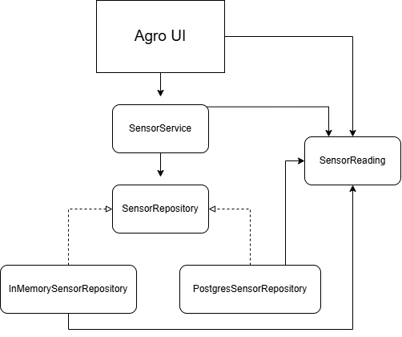

# Agro Management System

## Architecture and Module Matrix

| Module (Java Package) | Primary Function | Input Data | Output Result | Dependencies |
|---|---|---|---|---|
| Model (`com.agro.model`) | Data structure (`SensorReading`) | String id, double temp, double humidity | SensorReading object | None |
| Repository (`com.agro.repository`) | Data read/write operations (interface and implementations) | SensorReading or String fieldId | List<SensorReading> or boolean | `com.agro.model` |
| Service (`com.agro.service`) | Validation, standards analysis, reporting | Sensor readings, user requests | Report (`String` / DTO), notification | `model`, `repository` (via interface) |
| UI (`com.agro.ui`) | Request handling and result display | User input / requests | Console output / response | `service`, `model` |

## SensorService Contract (UI → Service)

- `String analyzeFieldCondition(String fieldId)` — analyzes readings for a specific field and returns a text-based report or the result of the assessment.
- `boolean registerNewSensorData(String fieldId, double temperature, double humidity)` — validates input parameters and saves the readings via `SensorRepository` (returns `true` on success, `false` if validation or saving fails).

## Component Diagram

