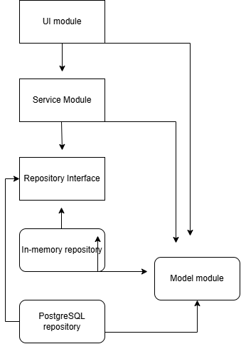

# Smart Agro Monitoring System

## Module Architecture

The agro-management-system is divided into four main modules:

* Model — data structures (`SensorData`, `User`) and their fields.
* Repository — a data access interface with two interchangeable implementations: In-Memory (for testing) and PostgreSQL (for the production environment).
* Service — business logic, processing of sensor readings, access control, and report generation.
* UI — handling user requests and displaying results.

## Module Interaction Matrix

| Module | Primary Function | Input Data | Output Result | Dependencies |
|---|---|---|---|---|
| Model | Defining data structures (`SensorData`, User`) | Raw values ​​(`sensorId, temperature, humidity, user data) | Data objects | None |
| Repository | Reading, writing, and searching for data via an interface and its implementations | Data objects or search parameters/time periods | List of records or status (`true`/`false`) | Model |
| Service | Processing readings, performing calculations, conducting checks, and generating reports | Sensor readings, time intervals, user requests | Reports, alerts, or operation results | Model, Repository interface |
| UI | Accepting user actions and displaying outcomes | User input (login/password, field ID, dates) | On-screen text/tables or report files | Service, Model |

## Component Diagram

